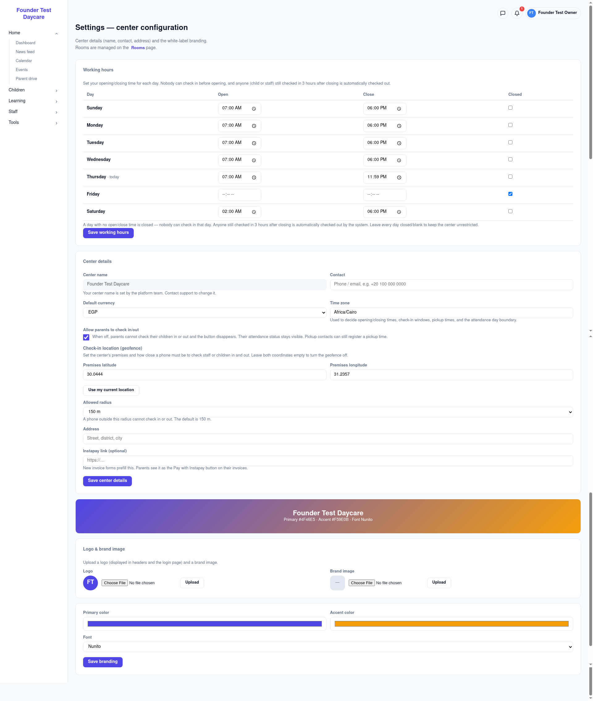
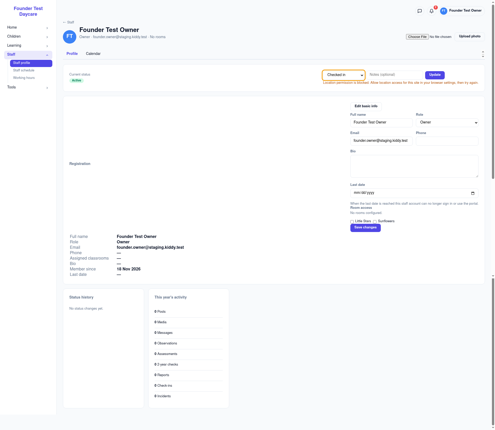
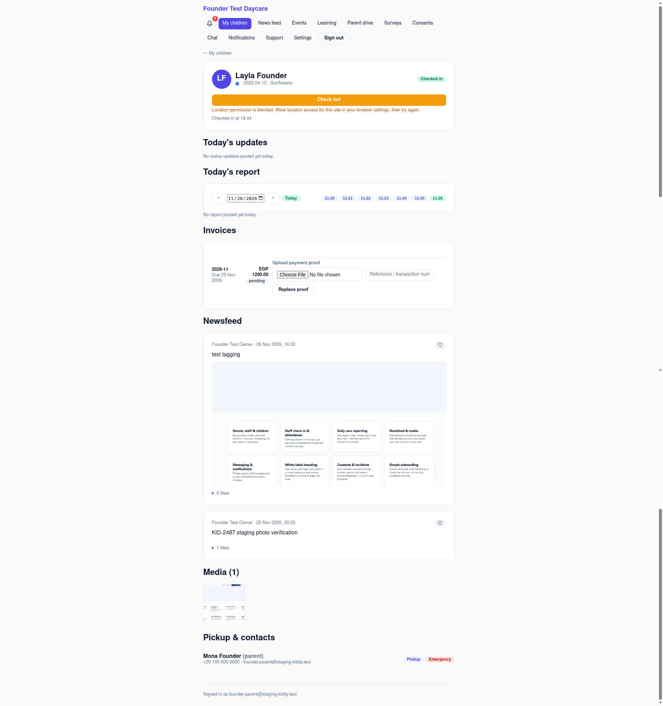

# KID-2503 — geofenced check-in/out (staging evidence)

Date: 2026-11-26. Author: Cody.

## What shipped

- Center settings gain **Premises latitude**, **Premises longitude**, and an
  **Allowed radius** selector with exactly 150 m / 300 m / 600 m (default
  150 m), plus a **Use my current location** helper. Both coordinates empty
  means the feature is off.
- The server computes haversine distance for staff self check-in/out and
  parent child check-in/out (web actions and the mobile parent API). Missing,
  malformed, or out-of-radius positions are refused with EN/AR copy.
- The captured coordinates and GPS accuracy are stored on `staff_status` and
  `check_in` rows. Admin overrides are marked with the admin's account and
  render as **Overridden by <admin>**.
- Admins acting on another staff member, or on a child from a management
  surface, bypass the fence without coordinates. An admin's own staff
  check-in/out stays fenced.
- The check-in UI shows the **Enable location access** control when the
  browser still permits a prompt, and the same blocked/unsupported guidance
  as the push-notification card when permission is denied.
- Existing before-opening / parent-toggle / pickup-time gates are unchanged.

Code: PR [#159](https://github.com/ANassef6/kiddy-daycare-mvp/pull/159),
merged to `staging` as `23655e2`.

## Deployed version

| Item | Value |
| --- | --- |
| Worker | `kiddy-web-staging` |
| Source | `origin/staging` @ `23655e2` |
| Deploy command | `npx opennextjs-cloudflare build` then `npx wrangler deploy --env staging` |
| Worker version | `344f7486-c6d9-42eb-8d94-420f0750843f` |
| Canonical host | `https://staging.kiddyapp.net` (HTTP 200 on `/login`) |
| Migration | `supabase/migrations/0060_kid2503_premises_geofence.sql` (applied by the app schema bootstrap) |

## Browser evidence (Skyvern, real Chromium)

### 1. Center settings — saved and persisted after reload

Skyvern run `tsk_601428254550224024` (owner `founder.owner@staging.kiddy.test`):
set latitude `30.0444`, longitude `31.2357`, radius `150 m`, pressed
**Save center details**, waited for the reload, and re-read the fields.

The values are server-rendered after the reload, so the save persisted.

### 2. Staff self check-in — location permission flow

Skyvern run `tsk_601431123588376970` (owner's own staff card): choosing
**Checked in** shows the explicit permission guidance instead of silently
failing. This browser session has geolocation denied, which is the same
blocked state the push-notification card handles with instruction text.

### 3. Parent child page — location permission flow

Skyvern run `tsk_601432132905692574` (parent `founder.parent@staging.kiddy.test`,
child **Layla Founder**): the check-out control shows the same blocked-location
guidance. The screenshot was taken while the API check below had the child
checked in; she was checked out again afterwards.

## Live server-side enforcement (mobile parent API)

The mobile parent endpoint uses the same `evaluateGeofence` function and the
same center settings as the web actions. Live transcript against
`https://staging.kiddyapp.net` with the parent fixture token:

| Request | Result |
| --- | --- |
| `POST /api/mobile/children/<layla>/check-in {"type":"in"}` | `422` — “Location is required to check in or out. Tap “Enable location access” and allow your browser to share your location.” |
| Same, `lat 30.06, lng 31.25` (≈2.2 km away) | `422` — “You are about 2214 m from the center. Move within 150 m to check in or out.” |
| Same, `lat 30.0449, lng 31.2359` (inside 150 m) | `200` — child checked in, coordinates sent |
| Check-out outside the radius | `422` — same distance refusal |
| Check-out inside the radius | `200` — child restored to checked out |

Unit coverage pins the stored coordinates, the override marker, settings
validation, and the distance/malformed/missing matrix (23 tests in
`tests/unit/kid2503-geofence.test.ts`).

## Checks

- `npx vitest run tests/unit/kid2503-geofence.test.ts` — 23/23.
- i18n parity/page-coverage + KID-2486 center-settings + KID-1329/KID-1371/
  KID-2447/KID-2454 regression suites — green.
- `npx tsc --noEmit` clean; `npx next lint` clean (pre-existing ``
  warnings only).
- `npm run db:verify-migrations` applies the full Postgres chain, including
  0060, green.
- `tests/unit/kid2432-migration-versions.test.ts` fails on this base because
  `staging`/`master` already carry duplicate 0055/0056 prefixes from earlier
  merges. KID-2503 adds 0060 and does not add a duplicate.

## Staging note

The automated settings run also changed **Thursday close** from 06:00 PM to
11:59 PM by touching the working-hours field while the task navigated the page.
That is a staging-fixture side effect, not a KID-2503 setting. Re-seed the
Founder Test Daycare fixture (`scripts/seed-staging-founder.ts`) to restore
Sun–Thu 07:00–18:00.
