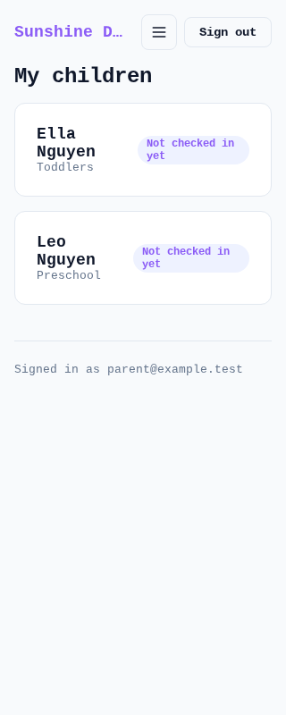
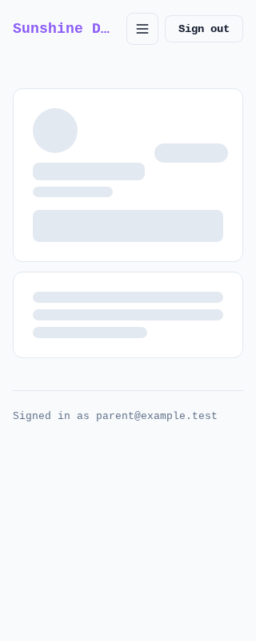
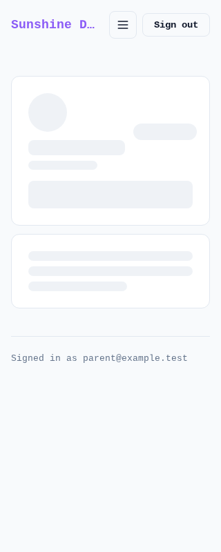
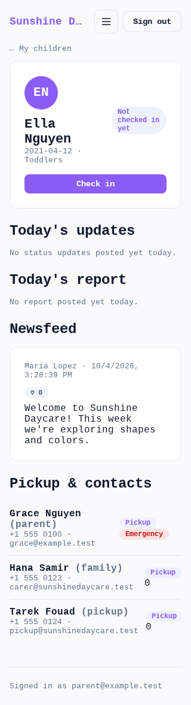
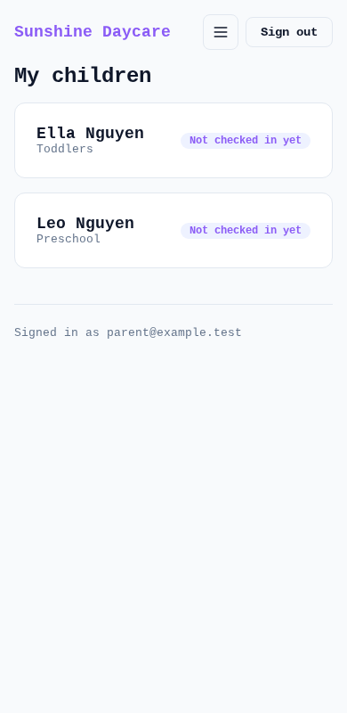
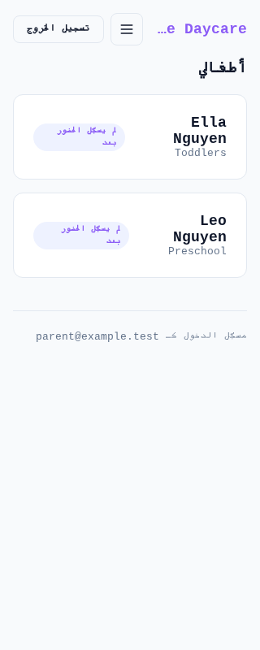
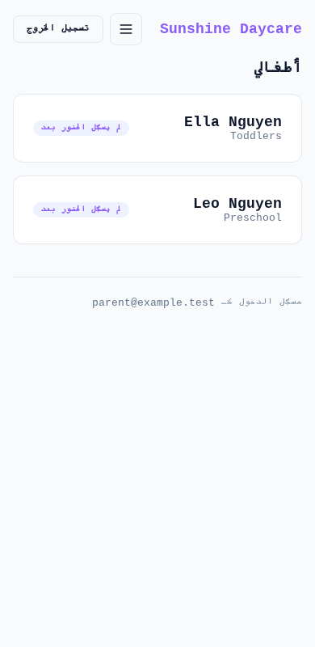
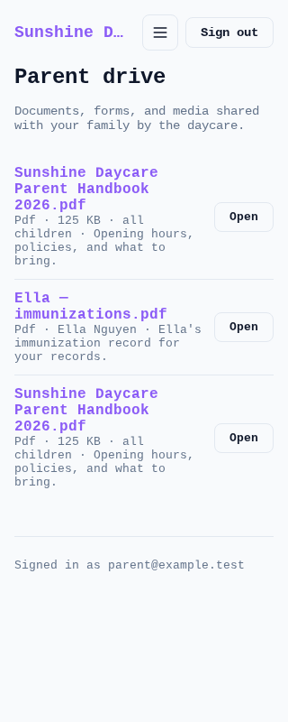

# KID-257: Parent app UI inspection (Android/mobile 320–430px), EN and AR

**Issue:** KID-257 Inspect parent app UI on Android/mobile viewports and report all defects
**Parent:** KID-253 Fix Android white-label branding per daycare and login-screen UI bugs
**Date:** 2026-10-30 (report revised after quality-gate return: live browser inspection added)
**App:** Next.js app in `kiddy-daycare-mvp/` (parent/child portal)
**Viewports inspected:** 320 and 390 px (live, real browser); metrics collected at every route
**Languages:** EN and AR — AR activated through the real flow (Account settings → العربية → Save, which sets `account.language` + `kiddy_lang` cookie), not by cookie injection
**Routes inspected:** `/login`, `/child` (dashboard), `/child/[id]` (child detail), `/child/newsfeed`, `/child/events`, `/child/learning`, `/child/drive`, `/child/forms`, `/child/consents`, `/child/messages`, `/child/support`, `/child/settings`, hamburger nav menu, sign-in/sign-out round trip

## Method (this audit, not code review)

- Next.js dev server run from an isolated copy of the repo with a private SQLite copy of `data/kiddy.db` (no shared state mutated), Chromium via Playwright, viewport 320×800 and 390×800.
- Per route × language × viewport: full-page screenshot, `document.documentElement.dir/lang`, `scrollWidth` vs `clientWidth`, sign-out button rectangle, burger/inline nav state, console errors, ≥400 responses. Raw data: [`route-audit-en.json`](route-audit-en.json), [`route-audit-ar.json`](route-audit-ar.json).
- DEF-001 stall evidence: Playwright route interception delays every fetch of `/child/[id]` by **7000 ms**; state sampled at fixed intervals after the tap. Raw timeline: [`def001-stall-matrix.json`](def001-stall-matrix.json).
- Contact-badge DOM proof: [`dom-contact-badges.txt`](dom-contact-badges.txt).
- Cross-cutting result: **`scrollWidth == clientWidth` on every route in EN and AR at 320 and 390 (no horizontal overflow anywhere); no console errors and no 4xx/5xx responses on any route**, except the duplicate React key on `/child/drive` (DEF-003).

---

## Known defects (confirmed, not fixed here)

### DEF-001: Tapping a child's name does nothing on Android — CONFIRMED FIXED (KID-254), with one residual window (see DEF-006)
- **Severity:** Blocker when present
- **Viewport:** 320–430 px (Android)
- **Repro steps (fixed state):**
  1. Sign in as parent, open `/child`
  2. Tap a child's card while the child-detail request is slow (network stall/throttling)
- **Expected:** Immediate feedback (URL + loading state) on tap
- **Before (KID-254 fix, `app/child/[id]/loading.tsx` removed for the test):** tap produces **nothing** — URL stays `/child`, list stays on screen, no skeleton — for the whole fetch. Measured: no change at +0.87 s or +3.74 s; detail landed at **8.0 s** (warm prefetch) and **14.7 s** (slow/cold, prefetch + navigation serialized).
  -  `def001-before-warm-1-tap-plus869ms-320.png`
  -  `def001-before-warm-2-stall-plus3741ms-320.png`
  -  `def001-before-warm-3-detail-loaded-8025ms-320.png`
  - worst case: `def001-before-slow-1/2/3-*.png` (no feedback at 0.9 s / 3.7 s, detail at **15.3 s**)
- **After (current code, same 7 s stall):** the moment the card is tapped the URL flips to `/child/[id]` and the `role="status" aria-busy` skeleton renders — measured URL + skeleton at **460 ms**, screenshot at **864 ms**, while the fetch is still stalled; the real page streams in when the stall lifts (8.0 s).
  -  `def001-after-warm-1-tap-plus864ms-320.png`
  -  `def001-after-warm-2-stall-plus3747ms-320.png`
  -  `def001-after-warm-3-detail-loaded-8048ms-320.png`
- **Residual:** if the tap happens while the detail route's **prefetch request is still in flight** (cold/slow network, tap within the first seconds of the list rendering), feedback is still delayed until that prefetch settles — measured no URL/skeleton for **7.4 s** after the tap (then skeleton, detail at 15.3 s). Filed as **DEF-006** below.
- **Blocks white-label launch:** was yes — now fixed on the standard path; DEF-006 is the follow-up.

### DEF-002: Sign-out button trimmed at the top-right corner — CONFIRMED FIXED (KID-255)
- **Severity:** Blocker when present
- **Viewport:** 320–430 px
- **Repro steps (fixed state, this audit):**
  1. Sign in as parent, view the header at 320 or 390 px
  2. Check the sign-out button geometry; open the hamburger menu and tap a link
- **Expected:** Sign-out fully visible and tappable at every width and language; nav collapses instead of cramping the row
- **Actual (live):** on **all 11 logged-in routes × {EN, AR} × {320, 390}** the sign-out rectangle is fully on-screen — EN right edge 304 px (320 viewport) / 374 px (390 viewport); AR mirrored (left 16 px, right 114 px) — and the nav collapses to the burger (`child-nav-burger` visible on all 46 sub-720 px child-route captures). Hamburger panel is 280 px wide and inside the viewport in both languages.
  -  `child-en-320.png`
  -  `child-en-390.png`
  -  `child-ar-320.png`
  -  `child-ar-390.png`
  - hamburger open: `nav-menu-open-en-320.png`, `nav-menu-open-ar-320.png`
  - geometry numbers: `route-audit-en.json`, `route-audit-ar.json` (`signOut.onScreen: true` everywhere)
- **Note:** the `docs/evidence/kid255/` before/after shots were captured by the fix work; the shots above are this audit's own confirmation.
- **Blocks white-label launch:** was yes — fixed, verified live.

---

## New defects found by this live inspection

### DEF-003: `/child/drive` lists institute-wide files once per child (duplicate rows + React key warning)
- **Severity:** Minor (misleading data display, console warning)
- **Viewport:** all 320–430 px, EN and AR
- **Steps:** sign in as the seeded parent (2 linked children) → open `/child/drive`
- **Expected:** each shared file listed once
- **Actual:** "Sunshine Daycare Parent Handbook 2026.pdf" (child_id NULL, shared with all children) renders **twice** (once per linked child); console: `Warning: Encountered two children with the same key, mutz75u3-zaywbs2d`
- **Evidence:**  `drive-en-320.png` (same in `drive-ar-320.png`, `drive-en-390.png`); console entry in `route-audit-en.json`
- **Root cause / proposed fix location:** `app/child/drive/page.tsx:15-23` — `families.map(c => driveFilesFor(institute, c.id))` includes `child_id IS NULL` rows for *every* child, then `flatMap`s them into one list keyed by `f.id`. Dedupe by file id (or fetch institute-wide rows once).
- **Blocks launch:** no (cosmetic/data duplication), but should be fixed — duplicate file rows + failed keys can drop/duplicate items on re-render.

### DEF-004: Arabic (AR) locale still shows hardcoded English on the login screen and five parent tabs
- **Severity:** Major for AR-facing use (cosmetic/localization, no functional break)
- **Viewport:** all 320–430 px in AR
- **Steps:** Account settings → العربية → Save (whole app flips to RTL/AR) → open the listed routes
- **Expected:** all user-facing strings in Arabic when the app language is AR
- **Actual (live, `dir=rtl`):**
  - `/login`: **entire screen untranslated** — "Sign in", "Welcome back…", "Email", "Password", "Forgot your password?", "Have an invite code? Activate your account", plus bidi artifacts in RTL ("?Forgot your password", broken wrap of "daycare's day")
  - `/child/newsfeed`: h1 "Newsfeed", buttons "Comment"/"Add a comment", "N likes · N comments" English while header/nav/footer are Arabic
  - `/child/events`: h1 "Events", subtitle, "Upcoming events", "Videos" English
  - `/child/drive`: h1 "Parent drive", subtitle, "Nothing shared yet." English
  - `/child/forms`: h1 "Forms & surveys" + subtitle English
  - `/child/consents`: h1 "Consents & approvals" English
  - Already translated (verified): nav menu, dashboard (`أطفالي`), child detail, learning, messages, support, settings, footer
- **Evidence:** `login-ar-320.png`, `login-ar-390.png`, `newsfeed-ar-320.png`, `events-ar-320.png`, `drive-ar-320.png`, `forms-ar-320.png`, `consents-ar-320.png`; correct-flow capture `settings-language-ar-selected-320.png`
- **Root cause / proposed fix location:** hardcoded literals, e.g. `app/login/page.tsx:81-82,119-136`, `app/child/newsfeed/page.tsx:23,53,61-62`, `app/child/events/page.tsx:19-22,45`, `app/child/drive/page.tsx:17-19`, `app/child/forms/page.tsx:18-19`, `app/child/consents/page.tsx:24` — route them through `tr(dict, …)` like the dashboard/detail pages do.
- **Blocks launch:** not functional — but for the AR/white-label market this is the first screen parents see; recommend fixing before AR-facing release. Triage: Mika (KID-253 owner).

### DEF-005: Stray "0" rendered next to contact badges on the child detail page
- **Severity:** Cosmetic
- **Viewport:** all 320–430 px, EN and AR
- **Steps:** open `/child/[id]` for a child whose contacts include rows with `is_emergency = 0` (or `is_pickup = 0`)
- **Expected:** badge shown only when the flag is set
- **Actual:** a literal `0` is rendered after the badges (e.g. "Pickup 0")
- **Evidence:** DOM proof in [`dom-contact-badges.txt`](dom-contact-badges.txt) (`Pickup <!-- -->0`); visible in `child-detail-en-320.png` / `child-detail-ar-320.png` contact rows
- **Root cause / proposed fix location:** `app/child/[id]/page.tsx:161-162` — `{c.is_pickup && <span…>}` / `{c.is_emergency && <span…>}`; SQLite returns numeric `0`, and React renders `0`. Fix: `!!c.is_pickup && …` or ternaries.
- **Blocks launch:** no (cosmetic).

### DEF-006: Tap feedback still silent while the detail prefetch is in flight (residual of DEF-001)
- **Severity:** Medium (same parent-visible symptom as DEF-001, narrower window)
- **Viewport:** 320–430 px, slow/cold network
- **Steps:** load `/child` on a throttled connection and tap a child within the first seconds, while the child-detail prefetch request has not yet returned
- **Expected:** URL + skeleton immediately on tap (what KID-254 delivers once the loading shell is cached)
- **Actual (live, 7 s stall on all detail requests):** no URL change and no skeleton for **7.4 s** after the tap — the navigation reuses the in-flight prefetch promise, so the loading boundary only commits when that prefetch settles. After that the skeleton does show, and the page loads when the stall lifts.
- **Evidence:** `def001-after-slow-1-tap-plus851ms-320.png` and `def001-after-slow-2-stall-plus3724ms-320.png` (still "My children"), timeline `url flips at 7392ms` in `def001-stall-matrix.json` (run `after_stalledPrefetch`)
- **Blocks launch:** no — the standard path is fixed (DEF-001 after-shot). Adverse finding stands for follow-up triage (Mika): e.g. commit the loading state on click without awaiting the in-flight prefetch.

### OBS-001: Stale `kiddy_lang` cookie vs `account.language` renders half-translated RTL
- **Severity:** Low / edge
- **Steps:** device A saves AR (cookie `kiddy_lang=ar`, `account.language=ar`); account language is later changed to EN from another device; device A's cookie stays `ar`
- **Actual:** root layout honours the cookie (`dir=rtl`) while page dictionaries honour `account.language` (English) → English text in an RTL layout
- **Evidence:** `stale-cookie-ar-account-en-child-320.png`
- **Blocks launch:** no.

### OBS-002: Touch-target heights below the 44 px recommendation
- Sign-out button 98×34 px; burger 40×40 px (both reachable, not clipped). Non-blocking; see `route-audit-*.json`.

### Non-findings checked and cleared
- Horizontal overflow: none — `scrollWidth == clientWidth` on every route × {EN, AR} × {320, 390}.
- `/child/events` showing "No upcoming events right now" is **correct** — the seeded fixture events are dated 2026-10-11 / 2026-10-18 (past) as of this audit; not a defect.
- Skip-link off-screen position is intentional (`left/right: -9999px`, focusable) in both directions.
- Sign-in/sign-out round trip at 320: `signin-1-form-filled-320.png` → `signin-2-landed-child-320.png` → `signout-3-back-to-login-320.png` — works, lands back on `/login`.

---

## Route coverage (live screenshots — this audit)

Every cell is a full-page screenshot captured in the running app (not code review).

| Route | EN 320 | EN 390 | AR 320 | AR 390 | Findings |
|-------|--------|--------|--------|--------|----------|
| `/login` (logged out) | `login-en-320.png` | `login-en-390.png` | `login-ar-320.png` | `login-ar-390.png` | Layout OK both languages/widths; **DEF-004** (untranslated + bidi in AR) |
| sign-in → `/child` round trip | `signin-1-form-filled-320.png`, `signin-2-landed-child-320.png` | — | — | — | OK |
| sign-out → `/login` | `signout-3-back-to-login-320.png` | — | — | — | OK |
| `/child` dashboard | `child-en-320.png` | `child-en-390.png` | `child-ar-320.png` | `child-ar-390.png` | No defects; sign-out + burger OK, no overflow |
| `/child/[id]` detail | `child-detail-en-320.png` | `child-detail-en-390.png` | `child-detail-ar-320.png` | `child-detail-ar-390.png` | **DEF-005** (stray "0"); otherwise OK, translated in AR |
| `/child/newsfeed` | `newsfeed-en-320.png` | `newsfeed-en-390.png` | `newsfeed-ar-320.png` | `newsfeed-ar-390.png` | EN OK; **DEF-004** (title/buttons EN in AR) |
| `/child/events` | `events-en-320.png` | `events-en-390.png` | `events-ar-320.png` | `events-ar-390.png` | EN OK; **DEF-004**; "no upcoming events" correct for past fixture dates |
| `/child/learning` | `learning-en-320.png` | `learning-en-390.png` | `learning-ar-320.png` | `learning-ar-390.png` | No defects (translated in AR) |
| `/child/drive` | `drive-en-320.png` | `drive-en-390.png` | `drive-ar-320.png` | `drive-ar-390.png` | **DEF-003** (duplicates + key warning); **DEF-004** (title EN in AR) |
| `/child/forms` | `forms-en-320.png` | `forms-en-390.png` | `forms-ar-320.png` | `forms-ar-390.png` | EN OK (button text wraps, still tappable); **DEF-004** |
| `/child/consents` | `consents-en-320.png` | `consents-en-390.png` | `consents-ar-320.png` | `consents-ar-390.png` | EN OK; **DEF-004** (title EN in AR) |
| `/child/messages` | `messages-en-320.png` | `messages-en-390.png` | `messages-ar-320.png` | `messages-ar-390.png` | No defects (translated in AR) |
| `/child/support` | `support-en-320.png` | `support-en-390.png` | `support-ar-320.png` | `support-ar-390.png` | No defects (own EN/AR toggle works) |
| `/child/settings` | `settings-en-320.png` | `settings-en-390.png` | `settings-ar-320.png` | `settings-ar-390.png` | No defects; language switch flow captured in `settings-language-ar-selected-320.png` |
| hamburger menu open (320) | `nav-menu-open-en-320.png` | — | `nav-menu-open-ar-320.png` | — | Panel 280 px, fully in viewport, all links + sign-out reachable |
| DEF-001 tap under 7 s stall | `def001-after-warm-*.png` / `def001-before-warm-*.png` / `def001-*-slow-*.png` | | | | See DEF-001/DEF-006 above |

---

## Launch classification

**Block white-label launch:**
- DEF-001 (child tap dead) — **fixed, verified live with stall evidence**
- DEF-002 (sign-out trimmed) — **fixed, verified live at 320/390, EN + AR**

**Should fix soon (non-blocking, for Mika's triage):**
- DEF-004 — untranslated login + 5 tabs in AR (recommend before AR-facing release)
- DEF-006 — residual silent tap while prefetch in flight (narrow slow-network window)
- DEF-003 — drive duplicate rows / React key warning

**Cosmetic / low:**
- DEF-005 (stray "0"), OBS-001 (stale lang cookie edge), OBS-002 (touch-target heights)

**No other route-level defects found** in the live pass: no horizontal overflow, no console errors, no failed requests on any inspected route at 320 and 390 px in EN and AR.

## Conclusion

The report is complete per the issue instruction — including live per-route screenshots at 320/390 in EN and AR, DEF-001 before/after evidence under a 7 s network stall, and the classification above. Adverse findings (DEF-003/004/005/006) remain open and belong to follow-up triage by the parent issue owner (Mika, KID-253).
